# Stage 3 testing report

This report covers the testing done on this fork of SpatialLM between 2026-10-29 and 2026-11-05. The goals were:

1. Run SpatialLM 1.1 on a 4 GB Turing GPU (NVIDIA T400).
2. Find the best way to turn a phone / MASt3R-SLAM room scan into a clean layout (walls, doors, windows, furniture).
3. Measure whether plane-fit geometry ("stage 3") improves SpatialLM's walls and openings.

The configuration chosen from these tests is in [CONFIG.md](CONFIG.md). The intermediate outputs (predictions, logs,
result JSONs) were deleted after this report was written. All numbers below were copied from those files before
deletion, and the figures in `docs/testing/figures/` were generated from them.

---

## 1. Test setup

### 1.1 Hardware and software

| Item | Value |
|---|---|
| GPU | NVIDIA T400, 4 GB VRAM, Turing architecture |
| Python env | `~/miniconda3/envs/spatiallm` (Python 3.11) |
| flash-attn | Not usable: flash-attn 2 needs Ampere or newer |
| Models | `manycore-research/SpatialLM1.1-Qwen-0.5B` and `SpatialLM1.1-Llama-1B`, stored in `models/` |

### 1.2 Code change needed for the T400

SpatialLM's point encoder (`spatiallm/model/sonata_encoder.py`) expects flash-attn. Two changes:

- If `flash_attn` cannot be imported, `Sonata.__init__` sets `enable_flash=False` instead of failing.
- In the non-flash attention path, at inference time and without relative position encoding, attention uses
  `torch.nn.functional.scaled_dot_product_attention`. The original code builds the full `(N', H, K, K)` attention
  matrix, which does not fit in 4 GB. The training path and the RPE path are unchanged.

### 1.3 Test data

**Ground-truth subset.** 10 scenes from the SpatialLM test set (`SpatialLM-Testset/`, ScanNet-style rooms with
hand-labelled layouts):

`scene0000_00, scene0007_01, scene0012_02, scene0021_00, scene0027_01, scene0032_00, scene0039_01, scene0046_01, scene0051_01, scene0058_01`

The subset has 50 GT walls, 23 doors and 9 windows. scene0021_00 is the largest cloud (414k points after
SpatialLM's voxel cleanup) and matters for the memory results below.

**User scans (no official GT).**

| Scan | Source | Alignment result | GT |
|---|---|---|---|
| Room 1 | MASt3R-SLAM reconstruction | scale 0.608, raw height 4.27 units | Hand-made reference layout: 4 walls, 1 door, 1 window |
| Room 2 ("p93") | MASt3R-SLAM reconstruction, 511 MB `.ply` | scale 0.772, raw height 3.37 units | None (proxy scores only) |

### 1.4 Metrics

- **F1@.25 / F1@.50.** SpatialLM's own `eval.py` matching (IoU 0.25 / 0.50) for walls, doors and windows,
  averaged over scenes, via `stage3/score.py`. Objects use `eval.py`'s 3D box F1 averaged over classes
  ("objects mean").
- **Seed noise.** SpatialLM samples its output (temperature 0.6, top-k 10, top-p 0.95), so one run is noisy.
  Most comparisons use 3 seeds (0, 1, 2) and report the mean and the min–max range.
- **Proxy scores without GT** (`stage3/render.py`), used on user scans:
  - *wall support*: mean fraction of each predicted wall's area with scan points within 7 cm;
  - *wall recall*: fraction of observed wall-surface points within 10 cm of a predicted wall;
  - *openings with gap*: doors/windows that have an empty area or a see-through behind them in the scan.

---

## 2. Methods tested

### 2.1 Preprocessing

| Step | Script | What it does |
|---|---|---|
| Alignment | `align.py` | Levels the cloud (floor normal to +z), finds the Manhattan frame from surface normals, puts walls on x/y, floor at z=0, and fixes metric scale from an assumed ceiling height (default 2.6 m). MASt3R-SLAM output has arbitrary scale and orientation, so this step is required. |
| Crop | `crop.py` | Keeps only points inside the plane-fit room footprint (+0.3 m margin) and between floor and ceiling. This removes what was seen through doors and windows. |

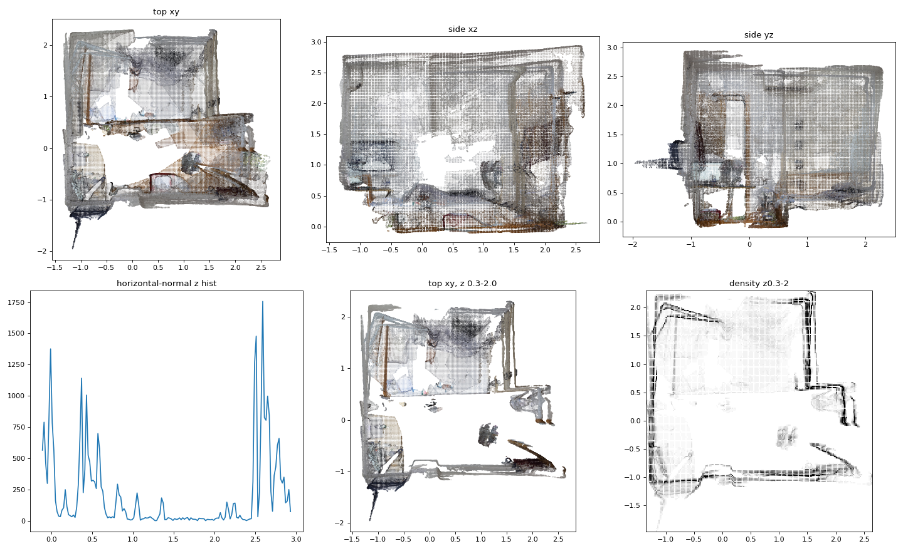

*Figure 1. Room 1 after `align.py`. The horizontal-normal histogram has the floor peak at z=0 and the ceiling peak
near 2.6 m. The density plot (z 0.3–2.0 m) shows straight, axis-parallel walls.*

### 2.2 SpatialLM variants

| Variant | Description |
|---|---|
| `all` task | One run predicts walls, doors, windows and boxes |
| `arch` task | Walls, doors and windows only |
| `object` task | Boxes only |
| Two-pass | Architecture from an `arch` run plus boxes from an `object` run |
| Greedy | `top_k=1` instead of sampling |
| Vote | Several seeds merged; an element is kept if it appears in at least half the runs, with median parameters |
| Precision | fp16, bf16, fp32 |
| Model | Qwen-0.5B vs Llama-1B |
| Input | Full cloud vs cropped cloud |

### 2.3 Geometry and hybrids

`planefit.py` builds a layout from geometry only. It detects floor and ceiling, finds axis-aligned wall planes,
builds the room footprint polygon, and looks for door/window gaps in the walls. It has two footprint settings:

- **sparse**: fixed low fill threshold, suited to sparse scans;
- **auto**: tries several thresholds and keeps the footprint whose walls have the most scan support.

The hybrids combine SpatialLM semantics with the plane fit. All of them keep SpatialLM's boxes unchanged.

| Variant | Walls | Doors / windows |
|---|---|---|
| `hyb_snap` | SpatialLM walls snapped onto the nearest fitted plane (≤ 0.35 m) and fitted corners; collinear walls merged | SpatialLM openings re-projected onto the snapped walls |
| `hyb_snap_pruned` | `hyb_snap`, minus SpatialLM walls that match no fitted plane and have < 5 % scan support | as `hyb_snap` |
| `hyb_geo` | Plane-fit walls | SpatialLM openings moved to the nearest compatible fitted wall |
| `hyb_geo_checked` | Plane-fit walls | Only openings with an empty area (> 35 %) or see-through (> 20 %) in the scan |
| `hyb_fusion` | Plane-fit walls | `hyb_geo_checked` + plane-fit openings that SpatialLM missed |
| `hyb_fusion_all` | Plane-fit walls | All SpatialLM openings + plane-fit openings that SpatialLM missed |

Only `hyb_snap` was kept in `stage3/hybrid.py`. The other variants were removed after these tests showed they are worse.

---

## 3. Results

Unless a section says otherwise: 10 GT scenes, `arch` task, F1@.25, mean of seeds 0–2 with [min–max].

### 3.1 Runtime and memory on the T400

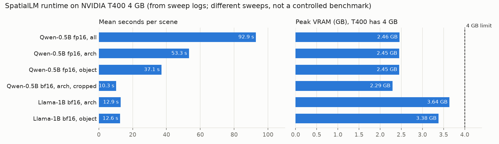

*Figure 2. Mean seconds per scene and peak VRAM, from the sweep logs.*

| Model, precision, task | Runs | Mean time / scene | Peak VRAM |
|---|---|---|---|
| Qwen-0.5B fp16, `all` | 17 | 92.9 s | 2.46 GB |
| Qwen-0.5B fp16, `arch` | 35 | 53.3 s | 2.45 GB |
| Qwen-0.5B fp16, `object` | 11 | 37.1 s | 2.45 GB |
| Qwen-0.5B bf16, `arch`, cropped input | 33 | 10.3 s | 2.29 GB |
| Llama-1B bf16, `arch` | 63 | 12.9 s | 3.64 GB |
| Llama-1B bf16, `object` | 11 | 12.6 s | 3.38 GB |
| Llama-1B bf16, `all` | 2 | 31.7 s | 3.24 GB |

Model load time was about 6.5 s for Llama-1B.

Observations:

- Qwen-0.5B ran on every scene and scan. Peak VRAM stayed below 2.5 GB.
- Llama-1B uses up to 3.7 GB and is at the limit of the card:
  - scene0021_00, full cloud (414k points): failed for every task and seed (`Empty()` from the generation
    thread, out of memory). The cropped cloud of the same scene (373k points) ran.
  - Room 2, `arch` on a 192k-point cloud: seed 0 failed, seeds 1 and 2 ran.
  - Room 2, `object`: failed at 130k and 207k points, ran at 119k points.
  - Memory depends on how long the generated output is, not only on point count. There is no safe point limit.
- The time numbers come from different sweeps under different conditions. Only the Llama sweep was noted as running
  with the GPU otherwise empty. Qwen `arch` took 53 s per scene in the first sweep and 10 s in a later one on cropped
  clouds. Treat the times as orders of magnitude, not a benchmark.

### 3.2 Precision

Qwen-0.5B, `all` task, seed 0, on scene0000_00, scene0021_00 and scene0046_01. fp32 failed on one scene, so the
fair comparison is the 2 scenes where all three precisions finished.

| Precision | Wall (2 scenes) | Door | Window | Objects mean | Wall (3 scenes) | Objects mean (3 scenes) |
|---|---|---|---|---|---|---|
| fp16 | 0.917 | 0.833 | 1.000 | 0.490 | 0.806 | 0.422 |
| bf16 | 0.917 | 0.833 | 1.000 | 0.490 | 0.806 | 0.393 |
| fp32 | 0.917 | 0.833 | 1.000 | 0.490 | 0.611 (failed scene scored empty) | 0.233 |

**Result:** precision makes no difference to layout quality. The T400 has no native bf16, but bf16 still runs, and it is
what the SpatialLM README uses.

### 3.3 SpatialLM decoding, task split and voting (single runs)

Qwen-0.5B, full cloud, seed 0 unless stated. F1@.25 (F1@.50 in brackets for walls).

| Variant | Wall | Door | Window | Objects mean | Pred walls / doors / windows (GT 50 / 23 / 9) |
|---|---|---|---|---|---|
| `all`, sampling (default) | 0.719 (0.719) | 0.465 | 0.540 | 0.460 | 71 / 19 / 15 |
| `all`, greedy (`top_k=1`) | 0.759 (0.751) | 0.546 | 0.540 | 0.548 | 71 / 17 / 16 |
| `all`, Llama-1B fp16 | 0.663 (0.654) | 0.575 | 0.556 | 0.486 | 65 / 13 / 14 |
| `all`, cropped input | 0.783 (0.783) | 0.502 | 0.717 | 0.423 | 58 / 17 / 14 |
| `arch`, seed 0 | 0.744 (0.744) | 0.565 | 0.640 | – | |
| `arch`, seed 1 | 0.764 | 0.542 | 0.433 | – | |
| `arch`, seed 2 | 0.721 | 0.578 | 0.633 | – | |
| Two-pass (`arch` s0 + `object` s0) | 0.744 | 0.565 | 0.640 | 0.498 | |
| Vote of 3 `arch` seeds (+ `object`) | 0.775 | 0.572 | 0.650 | 0.498 | |
| Plane-fit only, sparse | 0.754 | 0.000 | 0.167 | – | |
| Plane-fit only, auto | 0.663 | 0.000 | 0.278 | – | |

Findings:

- **Over-prediction.** Raw SpatialLM predicts 71 walls for 50 GT walls. Most of the wall error is extra or
  fragmented walls, which is what snapping fixes (see 3.4).
- **Task split.** Separate `arch` and `object` runs are better than one `all` run: walls 0.744 vs 0.719, doors
  0.565 vs 0.465, objects 0.498 vs 0.460.
- **Greedy decoding.** It helped on this subset (objects 0.548) but hurt badly on room 1 (wall 0.50, see 3.7), so it was not adopted.
- **Voting.** Gains are small (+0.03 walls) and the cost is 3× the runs.
- **Cropping.** Cropping clearly helps windows (+0.18 vs `all`) and walls. It hurts objects (0.423), because
  furniture near the walls is partly cut. Boxes should therefore come from the full cloud.
- **Plane fit alone.** It gets walls about right but finds almost no doors or windows. It is only useful combined with SpatialLM.

### 3.4 Hybrid variants vs. seed noise

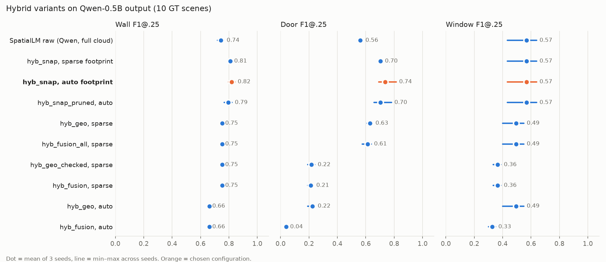

*Figure 3. All hybrid variants applied to the same three Qwen-0.5B `arch` samples (full cloud).*

| Method | Wall | Door | Window |
|---|---|---|---|
| SpatialLM only | 0.743 [0.72–0.76] | 0.561 [0.54–0.58] | 0.569 [0.43–0.64] |
| `hyb_snap`, sparse | 0.809 [0.80–0.82] | 0.704 [0.69–0.72] | 0.569 [0.43–0.64] |
| **`hyb_snap`, auto** | **0.818 [0.80–0.84]** | **0.737 [0.69–0.82]** | 0.569 [0.43–0.64] |
| `hyb_snap_pruned`, auto | 0.794 [0.77–0.82] | 0.704 [0.66–0.78] | 0.569 [0.43–0.64] |
| `hyb_geo`, sparse | 0.754 | 0.630 [0.61–0.65] | 0.494 [0.40–0.55] |
| `hyb_fusion_all`, sparse | 0.754 | 0.614 [0.57–0.64] | 0.494 [0.40–0.55] |
| `hyb_geo_checked`, sparse | 0.754 | 0.217 [0.19–0.24] | 0.364 [0.33–0.39] |
| `hyb_fusion`, sparse | 0.754 | 0.211 [0.19–0.23] | 0.364 [0.33–0.39] |
| `hyb_geo`, auto | 0.663 | 0.224 [0.19–0.24] | 0.494 [0.40–0.55] |
| `hyb_geo_checked`, auto | 0.663 | 0.041 [0.03–0.05] | 0.328 [0.30–0.35] |
| `hyb_fusion`, auto | 0.663 | 0.039 [0.03–0.05] | 0.328 [0.30–0.35] |

Findings:

- `hyb_snap` beats raw SpatialLM on walls (+0.07) and doors (+0.18) for **every** seed, and the min–max ranges do not
  overlap. Windows are unchanged because snapping keeps SpatialLM's windows.
- The `auto` footprint is slightly better than `sparse` for `hyb_snap`.
- Pruning unsupported walls removes real walls more often than wrong ones (−0.02 to −0.03).
- Variants that use **plane-fit walls** (`hyb_geo*`, `hyb_fusion*`) are limited by the plane fit (0.754 / 0.663 walls).
  With the `auto` footprint, doors collapse because openings get moved onto the wrong walls.
- **The scan-gap check is harmful.** `hyb_geo_checked` and `hyb_fusion` drop doors from about 0.63 to about 0.22.
  ScanNet doors are often closed or scanned from one side, so a real door does not show as a gap.

The same pattern holds on the cropped input:

| Method (cropped input) | Wall | Door | Window |
|---|---|---|---|
| SpatialLM only | 0.768 [0.72–0.80] | 0.518 [0.47–0.59] | 0.711 [0.65–0.77] |
| `hyb_snap`, sparse | 0.848 [0.84–0.86] | 0.688 [0.65–0.72] | 0.689 [0.65–0.72] |
| **`hyb_snap`, auto** | **0.857 [0.84–0.88]** | **0.722 [0.70–0.75]** | 0.689 [0.65–0.72] |
| `hyb_geo`, sparse | 0.754 | 0.641 [0.60–0.67] | 0.589 [0.57–0.60] |
| `hyb_fusion_all`, sparse | 0.754 | 0.628 [0.60–0.65] | 0.589 [0.57–0.60] |
| `hyb_geo_checked`, auto | 0.663 | 0.046 [0.03–0.07] | 0.389 [0.37–0.40] |

### 3.5 Building up the pipeline, and Qwen-0.5B vs Llama-1B

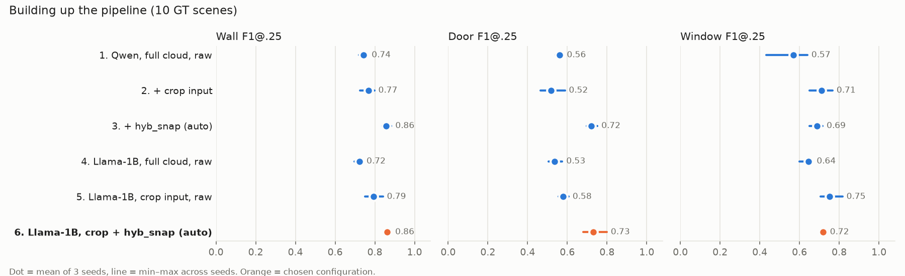

*Figure 4. Effect of each step on the 10 GT scenes. Llama "full cloud" includes the scene it cannot run (scored as empty).*

**10 scenes** (Llama full-cloud scene0021_00 counted as an empty prediction):

| Step | Wall | Door | Window |
|---|---|---|---|
| 1. Qwen, full cloud, raw | 0.743 [0.72–0.76] | 0.561 [0.54–0.58] | 0.569 [0.43–0.64] |
| 2. Qwen, crop, raw | 0.768 [0.72–0.80] | 0.518 [0.47–0.59] | 0.711 [0.65–0.77] |
| 3. Qwen, crop + `hyb_snap` | 0.857 [0.84–0.88] | 0.722 [0.70–0.75] | 0.689 [0.65–0.72] |
| 4. Llama, full cloud, raw | 0.724 [0.70–0.74] | 0.535 [0.51–0.57] | 0.644 [0.60–0.67] |
| 5. Llama, crop, raw | 0.795 [0.75–0.84] | 0.578 [0.55–0.61] | 0.752 [0.71–0.82] |
| **6. Llama, crop + `hyb_snap`** | **0.861 [0.85–0.88]** | **0.731 [0.68–0.80]** | **0.719 [0.71–0.73]** |

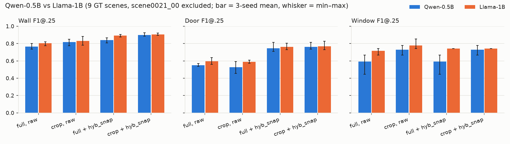

*Figure 5. The same comparison on the 9 scenes where Llama-1B runs on the full cloud.*

**9 scenes** (scene0021_00 excluded):

| Source | Qwen wall / door / window | Llama wall / door / window |
|---|---|---|
| Full cloud, raw | 0.767 / 0.550 / 0.593 | 0.804 / 0.594 / 0.716 |
| Crop, raw | 0.816 / 0.528 / 0.728 | 0.830 / 0.590 / 0.778 |
| Full + `hyb_snap` | 0.838 / 0.745 / 0.593 | 0.892 / 0.761 / 0.741 |
| Crop + `hyb_snap` | 0.900 / 0.761 / 0.728 | **0.904 / 0.768 / 0.741** |

Findings:

- Llama-1B looks worse than Qwen on 10 scenes only because of the out-of-memory scene. On the 9 scenes where it runs,
  it is better raw (+0.04 walls, +0.12 windows).
- After crop + `hyb_snap` the two models are within seed noise on walls and doors. Llama keeps a small window advantage
  (+0.01 to +0.03) and is less seed-sensitive on windows (range 0.71–0.73 vs 0.65–0.72).
- Crop and `hyb_snap` add up: crop mostly helps windows, and snapping mostly helps walls and doors.
- Overall gain from raw Qwen to the chosen configuration: walls **0.743 → 0.861**, doors **0.561 → 0.731**,
  windows **0.569 → 0.719**.

### 3.6 Per-scene breakdown

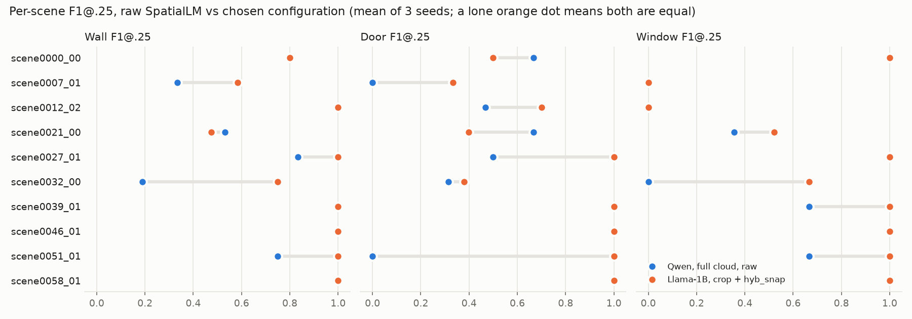

*Figure 6. Per-scene F1@.25, mean of 3 seeds. Blue = Qwen full cloud raw, orange = Llama-1B crop + `hyb_snap`.*

| Scene | Raw wall | Final wall | Raw door | Final door | Raw window | Final window |
|---|---|---|---|---|---|---|
| scene0000_00 | 0.79 | 0.80 | 0.67 | 0.50 | 1.00 | 1.00 |
| scene0007_01 | 0.33 | 0.58 | 0.00 | 0.33 | 0.00 | 0.00 |
| scene0012_02 | 1.00 | 1.00 | 0.47 | 0.70 | 0.00 | 0.00 |
| scene0021_00 | 0.53 | 0.47 | 0.67 | 0.40 | 0.36 | 0.52 |
| scene0027_01 | 0.83 | 1.00 | 0.50 | 1.00 | 1.00 | 1.00 |
| scene0032_00 | 0.19 | 0.75 | 0.31 | 0.38 | 0.00 | 0.67 |
| scene0039_01 | 1.00 | 1.00 | 1.00 | 1.00 | 0.67 | 1.00 |
| scene0046_01 | 1.00 | 1.00 | 1.00 | 1.00 | 1.00 | 1.00 |
| scene0051_01 | 0.75 | 1.00 | 0.00 | 1.00 | 0.67 | 1.00 |
| scene0058_01 | 1.00 | 1.00 | 1.00 | 1.00 | 1.00 | 1.00 |

- The biggest gains are on scenes where raw SpatialLM fragments the walls: scene0032_00 (walls 0.19 → 0.75) and scene0051_01
  (doors 0.00 → 1.00).
- Two scenes got worse:
  - scene0021_00, the largest room: walls drop 0.53 → 0.47 and doors 0.67 → 0.40. Qwen crop + `hyb_snap` drops
    the same way (0.47 / 0.37), so the loss comes from the crop + snap steps, not from the model.
  - scene0000_00: doors drop 0.67 → 0.50. This is Llama-specific; Qwen crop + `hyb_snap` keeps 0.67.
- scene0007_01 and scene0012_02 windows stay at 0 for every method: both models miss them.

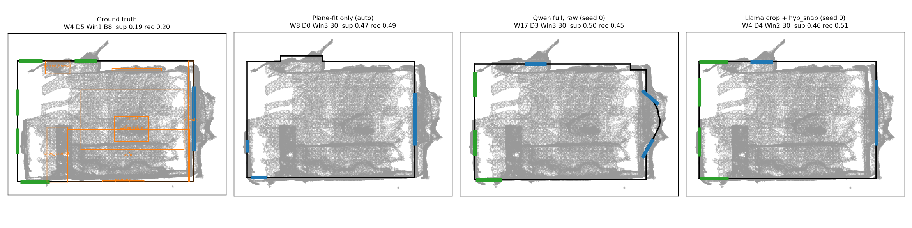

*Figure 7. scene0032_00, top view (grey = scan, black = walls, green = doors, blue = windows, orange = GT boxes).
Raw Qwen produces 17 wall segments, including a curved run of walls outside the room on the right. The final
layout has 4 walls matching the GT rectangle, 4 doors (GT: 5) and the GT window on the right wall, plus one extra window
on the top wall.*

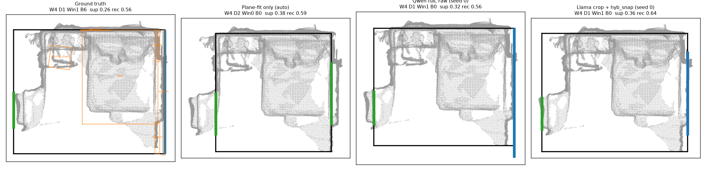

*Figure 8. scene0051_01. Raw SpatialLM already has 4 walls, 1 door and 1 window, but its door scores 0 at IoU 0.25
(mean of 3 seeds). After crop + snapping, walls, door and window all match (F1 1.0).*

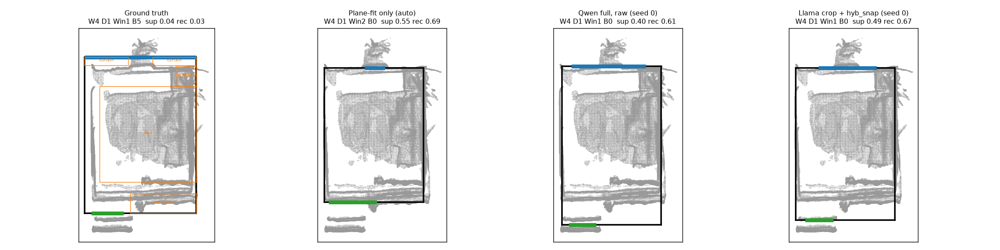

*Figure 9. scene0007_01. The GT room is larger than the scanned area (GT walls lie outside the points), so every
method that follows the scan scores lower on walls. This scene limits what geometry snapping can achieve.*

### 3.7 User scan, room 1 (hand-made reference)

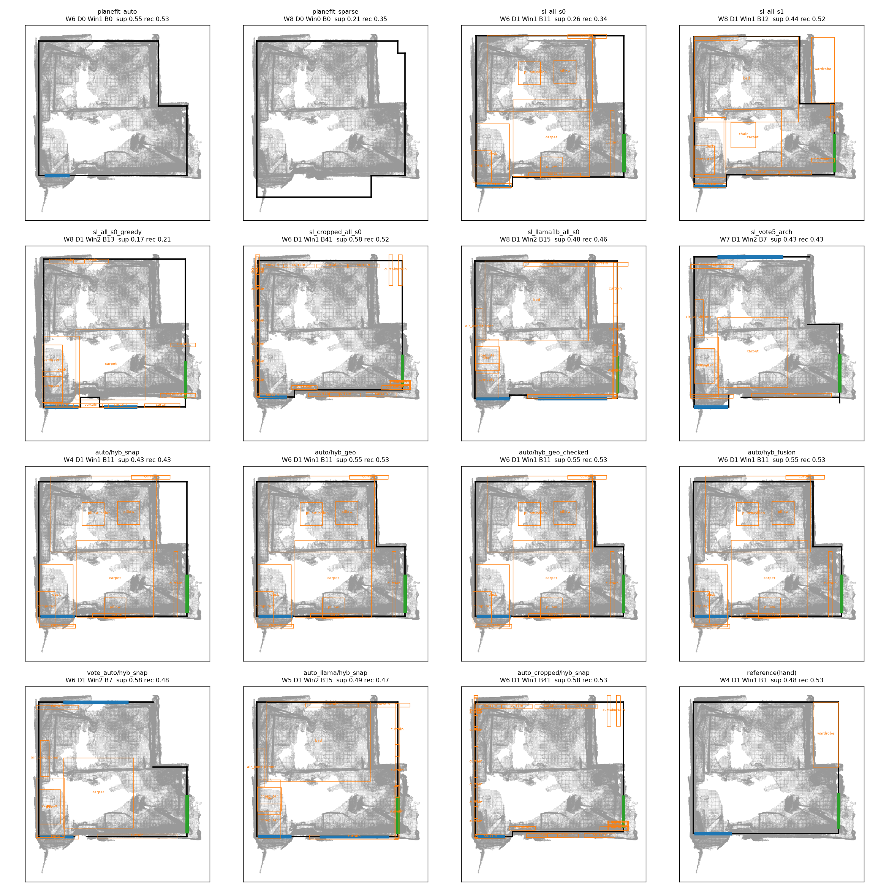

*Figure 10. Room 1, top view of every method plus the hand reference (bottom right). The title of each panel shows counts
(W walls, D doors, Win windows, B boxes) and the proxy scores (support, recall).*

F1@.25 against the hand reference (4 walls, 1 door, 1 window). One room only, so these numbers are anecdotal.

| Method | Wall | Door | Window | Walls predicted |
|---|---|---|---|---|
| Qwen `all`, seed 0 | 0.800 | 1.0 | 0.0 | 6 |
| Qwen `all`, seed 1 | 0.667 | 1.0 | 0.0 | 8 |
| Qwen `all`, seed 2 | 0.571 | 1.0 | 0.0 | 10 |
| Qwen `all`, seed 3 | 0.615 | 1.0 | 1.0 | |
| Qwen `all`, seed 4 | 0.533 | 1.0 | 0.667 | |
| Llama-1B `all`, seeds 0 / 1 / 2 | 0.667 / 0.500 / 0.667 | 1.0 / 0.0 / 1.0 | 0.667 / 0.500 / 0.500 | |
| Greedy | 0.500 | 1.0 | 0.0 | |
| Cropped input | 0.800 | 1.0 | 1.0 | |
| Vote of 5 `arch` seeds | 0.727 | 1.0 | 0.0 | |
| Plane-fit only, auto | 0.800 | 0.0 | 0.0 | |
| Plane-fit only, sparse | 0.500 | 0.0 | 0.0 | |
| `hyb_geo` / `hyb_fusion` (auto) | 0.800 | 1.0 | 1.0 | |
| **`hyb_snap`, auto** | **1.000** | **1.0** | **1.0** | |

Proxy scores (no GT needed):

| Method | Walls | Doors | Windows | Boxes | Wall support | Wall recall |
|---|---|---|---|---|---|---|
| Hand reference | 4 | 1 | 1 | 1 | 0.48 | 0.53 |
| Plane-fit auto | 6 | 0 | 1 | 0 | 0.55 | 0.53 |
| Qwen `all` s0 | 6 | 1 | 1 | 11 | 0.26 | 0.34 |
| Qwen `all` s1 | 8 | 1 | 1 | 12 | 0.44 | 0.52 |
| Qwen greedy | 8 | 1 | 2 | 13 | 0.17 | 0.21 |
| Qwen cropped | 6 | 1 | 1 | 41 | 0.58 | 0.52 |
| Llama-1B `all` s0 | 8 | 1 | 2 | 15 | 0.48 | 0.46 |
| `hyb_snap` (Qwen cropped) | 6 | 1 | 1 | 41 | 0.58 | 0.53 |
| `hyb_snap` (Llama) | 5 | 1 | 2 | 15 | 0.49 | 0.47 |

**Scale sensitivity.** The same scan aligned with a wrong ceiling-height guess:

| Assumed ceiling | Wall | Door | Window |
|---|---|---|---|
| 2.3 m | 0.727 | 1.0 | 0.0 |
| 2.6 m (used) | 0.800 | 1.0 | 0.0 |
| 2.9 m | 0.400 | 0.0 | 0.0 |

A 12 % scale error was enough to lose the door. Metric scale from `align.py` matters.

Findings: raw SpatialLM varies a lot between seeds on a real scan (walls 0.53–0.80). `hyb_snap` removes most of that
variance because walls end up on the scan planes. Cropping the input produces many more boxes (41), mostly
duplicated curtains along the walls.

### 3.8 User scan, room 2 ("p93")

Pipeline: `align.py` → `crop.py` → Llama-1B bf16 `arch` (seeds 0–2) on the cropped cloud + `object` (seed 0) →
`hybrid.py` (`hyb_snap`, auto) → `export_3d.py`.

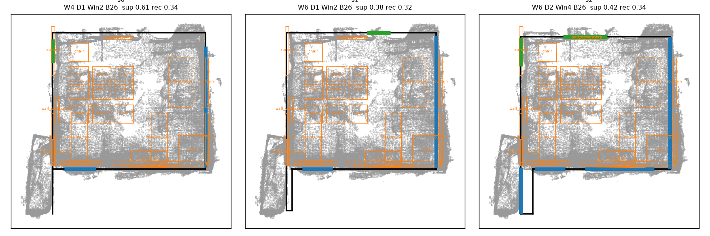

*Figure 11. Room 2, final layouts from three Llama seeds (same boxes).*

| Seed | Walls | Doors | Windows | Boxes | Wall support | Wall recall | Openings with gap |
|---|---|---|---|---|---|---|---|
| s0 | 4 | 1 | 2 | 26 | 0.61 | 0.34 | 3/3 |
| s1 | 6 | 1 | 2 | 26 | 0.38 | 0.32 | 3/3 |
| s2 | 6 | 2 | 4 | 26 | 0.42 | 0.34 | 6/6 |

Seed 0 gives the cleanest room (4 walls, highest support). Seeds 1 and 2 add a wall stub into the alcove at the
bottom left. Wall recall is low for all seeds because much of the wall surface is hidden behind furniture (26 boxes:
chairs, tables, clothes racks). This shows why it helps to run a few seeds and keep the one with the highest wall
support.

### 3.9 3D export

`export_3d.py` converted the final layouts of both rooms to binary glTF: `room.glb` (walls with real door/window holes,
door and window panels, floor) and `room_with_scan.glb` (plus up to 300k scan points). The layout-only files were
11–14 kB, and the versions with the scan were about 4.8 MB.

---

## 4. Conclusions

1. **SpatialLM 1.1 runs on a 4 GB Turing GPU** with the SDPA fallback in `sonata_encoder.py`. Qwen-0.5B fits
   every scene tested. Llama-1B is at the memory limit and fails on some large clouds or long outputs.
2. **Snapping to plane-fit geometry (`hyb_snap`) is the biggest single gain:** +0.07 to +0.09 wall F1 and +0.15 to
   +0.20 door F1, beyond seed noise, for both models and both input types.
3. **Cropping the input to the room footprint** mainly improves windows (+0.11 to +0.14 over 3 seeds). Boxes are better from the full cloud.
4. **Llama-1B ≥ Qwen-0.5B** when it fits, mainly on windows. After crop + snap the difference is small.
5. **Precision does not matter.** Greedy decoding and seed voting give inconsistent or small gains.
6. **Do not trust the scan-gap check for openings.** Every variant that filters SpatialLM's doors by scan evidence
   (`hyb_geo_checked`, `hyb_fusion`) loses most true doors.
7. **Correct metric scale is critical.** A wrong ceiling-height guess (2.9 m instead of 2.6 m) halved wall F1 on room 1.

## 5. Limitations

- Only 10 GT scenes and 2 user rooms were tested. On the GT set, differences below about 0.03 are within seed noise.
- The user-scan "GT" for room 1 was drawn by hand. Room 2 has no GT.
- Runtime numbers were not measured under controlled conditions.
- `align.py` assumes a ceiling height (2.6 m by default) to set the scale. A room with a different ceiling needs the
  correct `--ceiling_height`.
